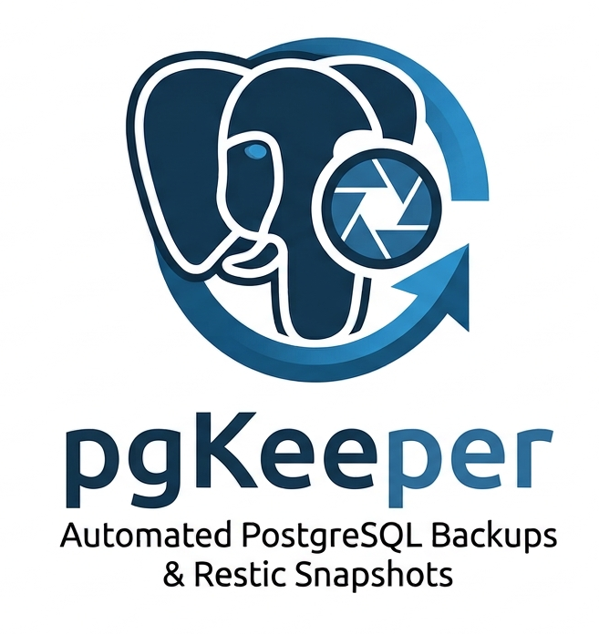

# pgkeeper

pgkeeper schedules PostgreSQL backups from Docker containers, stores snapshots
with [restic](https://restic.net/), and provides a web interface and REST API
for backup activity.

## Run with Docker Compose

This production-oriented template runs pgkeeper against a PostgreSQL container
that you already operate on the Docker host. It does not create or manage a
database container. pgkeeper uses the Docker socket to run `pg_dump` inside the
configured database container, so mounting that socket gives it control over
the host Docker daemon. Only deploy this template on a trusted host.

Save the following as `docker-compose.pgkeeper.yaml`:

```yaml
services:
  pgkeeper:
    image: ghcr.io/banshee-lab/pgkeeper:latest
    restart: unless-stopped
    ports:
      - "8080:8080"
    environment:
      RESTIC_PASSWORD: ${RESTIC_PASSWORD:?Set RESTIC_PASSWORD in .env}
      OIDC_ISSUER: ${OIDC_ISSUER:?Set OIDC_ISSUER in .env}
      OIDC_CLIENT_ID: ${OIDC_CLIENT_ID:?Set OIDC_CLIENT_ID in .env}
      OIDC_CLIENT_SECRET: ${OIDC_CLIENT_SECRET:?Set OIDC_CLIENT_SECRET in .env}
      OIDC_REDIRECT_URL: ${OIDC_REDIRECT_URL:?Set OIDC_REDIRECT_URL in .env}
    group_add:
      - "${DOCKER_GID:?Set DOCKER_GID to the Docker socket group ID}"
    volumes:
      - ./pgkeeper.toml:/etc/pgkeeper/pgkeeper.toml:ro
      - /var/run/docker.sock:/var/run/docker.sock
      - pgkeeper_data:/var/lib/pgkeeper

volumes:
  pgkeeper_data:
```

Create `pgkeeper.toml` next to the Compose file:

```toml
[global]
listen    = ":8080"
db_path   = "/var/lib/pgkeeper/pgkeeper.db"
log_path  = "/var/lib/pgkeeper"
temp_path = "/var/lib/pgkeeper"

[auth]
issuer       = "${OIDC_ISSUER}"
client_id    = "${OIDC_CLIENT_ID}"
secret       = "${OIDC_CLIENT_SECRET}"
redirect_url = "${OIDC_REDIRECT_URL}"

[restic]
repository = "s3:s3.example.com/pgkeeper/production"
password   = "${RESTIC_PASSWORD}"
keep-daily = 7

[backup.main]
cron      = "@daily"
container = "postgres-main"
database  = "app"
username  = "postgres"
host      = "localhost"
```

Create a `.env` file in the same directory. Replace every placeholder with the
values for your deployment; keep this file private and out of version control:

```dotenv
# Host Docker socket group; get it with: stat -c '%g' /var/run/docker.sock
DOCKER_GID=998

RESTIC_PASSWORD=replace-with-a-strong-restic-password

OIDC_ISSUER=https://identity.example.com/realms/example
OIDC_CLIENT_ID=pgkeeper
OIDC_CLIENT_SECRET=replace-with-your-oidc-client-secret
OIDC_REDIRECT_URL=https://pgkeeper.example.com/auth/callback
```

For S3-compatible restic storage, also pass the backend's required credentials
to the pgkeeper service (for example `AWS_ACCESS_KEY_ID` and
`AWS_SECRET_ACCESS_KEY`). Adapt the repository URL and credential settings for
your chosen restic backend.

Register the redirect URL with your OIDC provider. Put pgkeeper behind HTTPS in
production and set `OIDC_REDIRECT_URL` to its public callback address. The
example's OIDC settings are required: without `[auth]`, the API is unauthenticated.
Replace `postgres-main` in the TOML with the name of the existing database
container. Ensure it is managed by the Docker daemon whose socket is mounted
above. PostgreSQL authentication must already work non-interactively inside
that container (for example, with `.pgpass`); pgkeeper does not pass database
passwords to `pg_dump`.

Pull the image and start the service:

```sh
docker compose --file docker-compose.pgkeeper.yaml pull
docker compose --file docker-compose.pgkeeper.yaml up --detach
```

The web interface is available through your HTTPS reverse proxy, which can
connect to `127.0.0.1:8080` on the host. The named volume preserves pgkeeper's
SQLite database, execution logs, and temporary files across container
recreation. The PostgreSQL container and its data remain managed separately.
Configure a remote restic repository and provide its required backend
credentials so snapshots are stored independently of this host.

## Configuration

Configuration is strict TOML. Environment variables are expanded in TOML
string values using `${NAME}` (required) or `${NAME:-default}` (fallback).
See [the full example](examples/pgkeeper.toml), [environment variable
details](docs/environment.md), and the [API contract](docs/openapi.yaml).

## Development

Requirements: Go, Node.js, and Yarn. From the repository root:

```sh
make build
make test
make run CONFIG=./local/pgkeeper.toml
```

See `make help` for additional build and test targets.
